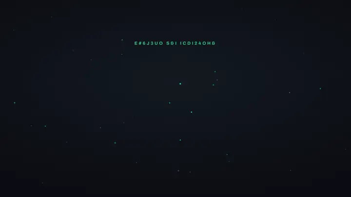

# Unyson+ Kinetic Scenes

**Motion graphics on a timeline, in the browser: animated headlines, 3D, captions and footage, for web pages and for
videos.** Free, nothing to install to start, and it works with your AI agent.

<p align="center"></p>

**Try it now: https://kinetic-scenes.unysonplus.com/** · The manual: https://docs.unysonplus.com/kinetic-scenes ·
The roadmap: https://docs.unysonplus.com/kinetic-scenes/roadmap

## What you can make

- **Website heroes and sections** that export as **plain HTML**: one file, or an embed for any page (a WordPress Custom
  HTML block works). They play as the page loads, as it scrolls, or click by click like slides.
- **Videos**: MP4 or WebM in 16:9, 9:16 (Shorts, Reels, TikTok), square or 4:5, with music, a voice-over and captions
  styled word by word. Rendered frame by frame, so every frame is exact.
- **Footage edits**: cut a person out and put a title behind them, reframe wide footage for a tall video so it follows
  the face, cut a long video down to a reel, edit a talking head by deleting words from its transcript.
- **Real 3D**: extruded text and logos, shapes and glTF models, in the same timeline as everything else.
- **One design, many videos**: fill a scene from a spreadsheet and render a video per row.

It works by hand (drag presets onto a timeline; **Check scene** points out what could be better) or with AI: the
built-in **AI assist**, or your own agent (Claude Code, Cursor, Codex) through the
[Unyson+ AI Dev Kit](https://github.com/UnysonPlus/UnysonPlus-AI-Dev-Kit), which also renders the videos and runs
the footage tools on your computer.

## Quick start

To use it, just open **https://kinetic-scenes.unysonplus.com/**. To run it from this code (Node.js 20 or newer):

```
git clone https://github.com/UnysonPlus/UnysonPlus-Kinetic-Scenes.git
cd UnysonPlus-Kinetic-Scenes
npm start
```

`npm start` installs what is needed the first time, builds the player, serves the Studio and opens it in your browser.

## FAQ

**Is it free?** Yes. The Studio is free to use, and what you make with it is yours.

**Do I need to install anything?** Not to design and export web scenes: the Studio runs in the browser. Video
rendering, AI assist and the footage tools (cut-out, reframing, transcription, voice and music separation) run in the
free AI Dev Kit on your own computer; nothing is uploaded to a server.

**Can it make videos without the AI Dev Kit?** In Chrome with its HTML-in-Canvas feature switched on, the Studio
renders an MP4 itself. Otherwise the kit renders it.

**Where are my scenes saved?** In your browser as you work, as a `.scene.json` file you save, or, with the AI Dev Kit,
in a project folder on your computer that you and your AI agent share.

**Will a scene I embedded break when the player is updated?** No. Every player version is published once and never
changes; an embed keeps the version it was made with.

**Can I use my AI agent?** Yes: connect it once through the AI Dev Kit (`studio-cli connect`) and it can make,
check and preview scenes in the same projects you open in the Studio.

**Which stock footage and music can I use?** The Studio's **Insert › Free stock** searches sources whose licences
allow commercial use and records each file's licence; the manual lists more:
https://docs.unysonplus.com/kinetic-scenes/stock-media

**I found a bug or have an idea.** Open an issue (the forms ask for what helps), or a pull request (see below).

## Contributing

Issues and pull requests are welcome. Issues labelled **good first issue** are small and self-contained. Before a
pull request: `npm run typecheck` and `npm run build` (the build stops if the player changed without a version bump),
plus `npm run selftest` if you changed the player.

## What's here

| Folder | What it is |
|---|---|
| `packages/player` | The scene player: the scene file format (`schema/scene.schema.json`), its validator, the responsive stage, the preset catalogue and the GSAP timeline builder. Builds to `dist/scene-player.iife.js` (the self-contained script exported pages load) and `dist/scene-editor.iife.js` (the Studio's in-preview editor: selection, dragging, resizing and in-place text editing; never shipped in exports). |
| `apps/studio` | The Studio web app (React + TypeScript + Vite): a preset library, a device-sized preview you edit directly (select one or many, drag, resize, double-click to edit text, Align and Distribute, lock layers), a timeline (drag, trim, zoom, drop presets), an inspector with per-breakpoint layouts, undo and redo, browser autosave, project files (`.scene.json`) and HTML export. |

## Develop

Requires Node.js 20 or newer.

```
npm start          # installs what is needed, then the same as npm run dev, and opens the browser
npm install
npm run dev        # builds the player, then serves the Studio at http://localhost:5173
npm run build      # production build into apps/studio/dist
npm run typecheck
```

After changing the player, run `npm run build:player` (the Studio inlines the built player into its preview
and its exported files).

## The scene file in brief

A scene has a **stage** (an aspect ratio per breakpoint, a height mode and a safe area), **layers** drawn
bottom to top (text, shapes, images), and on each layer the **clips** that animate it. A clip is a preset
placed in time with its own settings. Positions are percentages of the stage and sizes are "stage units"
(1 = 1% of the stage width), so a scene draws the same at any size. Each breakpoint can override a layer's
position, size and type; the clips are shared.

Groups: a `group` layer holds `layers` of its own. Its children keep stage coordinates (grouping never moves
anything) and their clips run on the group's clock, starting at the group's `start`, so moving a group in time
moves its whole animation. Presets on the group itself animate its measured frame as a whole.

Height modes:

- `ratio` keeps the shape; the page scrolls if the stage is taller than the window.
- `ratio-capped` keeps the shape but never grows taller than the window; the designed frame is trimmed
  top and bottom, which the safe area allows for.
- `fill` is exactly one window tall.

Presets cover text, reveals and exits, movement, emphasis, 3D, footage effects and transitions. Their settings are
described in `packages/player/src/presets/catalog.ts`, which the Studio uses to build its forms.

## Keyboard

| Keys | Does |
|---|---|
| Space | Play or pause |
| Home | Go to the start |
| `,` and `.` | Step one frame back or forward (Shift: one second) |
| Arrow keys | Nudge the selected layer (Shift: further), move the selected clip in time, or step the playhead |
| Delete | Delete the selected clip or layer |
| Ctrl+Z, Ctrl+Shift+Z | Undo, redo |
| Ctrl+D | Duplicate the selected layer |
| Ctrl+G, Ctrl+Shift+G | Group the selected layers, ungroup the selected group |
| Double-click a group | Open it: its layers on its own clock, everything else dimmed (Escape steps back out) |
| Ctrl+S | Save the project file |
| Shift or Ctrl + click (stage) | Add a layer to (or remove it from) the selection |
| Click, then Shift + click (timeline) | Select every layer between the two rows (Ctrl + Shift adds the range to the selection) |
| Ctrl + click (timeline) | Add a layer to (or remove it from) the selection |
| Drag on empty stage | Box-select the layers it touches (Shift or Ctrl adds to the selection) |
| Ctrl+A | Select every unlocked layer |
| F2, or double-click a layer's name | Rename it in place (double-clicking a group opens it) |
| Right-click a timeline row | Rename, open group, duplicate, group or ungroup, lock, delete |
| F | Play full screen (presenter mode for click-to-advance scenes) |
| M | Add a marker at the playhead |
| Escape | Clear the selection |
| Alt while dragging | Turn snapping off |

## Two ways to make a scene

- **By hand.** Drag presets onto the timeline. Their defaults follow measured motion-design timing, and
  **Check scene** (the Check tab) points out what could be better as you work: text that leaves before it
  can be read, text too small on a screen size, text off the stage or on other text, two clips fighting
  over one layer, long stretches where nothing moves. Most items have a one-click fix.
- **With AI, then by hand.** **✦ AI assist** (bottom right of the stage) is a chat with the AI Dev Kit on
  your computer. Each answer is a change to the scene: one undo step, a "Go back to before this" link,
  and a Check scene count. Select layers first to change only those. Check scene's **Fix with AI** sends
  its findings to the AI.

The AI writes scene data only, never code, and receives the Studio's motion rules with every request
(`apps/studio/src/lib/motionRules.ts`), the same rules Check scene measures.

### Motion rules and eases

Clips can use twelve **measured eases** (Soft land, Snap and settle, Glide, Whip, Pop over, Crash in,
Bounce hard, Cruise, Soft in-out, Gentle in, Leave, Crash out), listed first in the Easing menu with what
each is for. Exits default to **Leave**, which speeds up out of frame. Staggered text presets have a
**Rhythm** setting: natural (uneven, seeded gaps, the default) or even.

The ease parameters and several timing rules come from frame-by-frame measurements of professional motion
pieces published in the motionmaxxing project (Apache-2.0); the review checklist ideas also draw on the
favstash AI video editing skills (Apache-2.0). Both are re-expressed here in our own code.

### Sound

**+ Audio** adds a voice-over, music or a sound effect (MP3, WAV, OGG, M4A; uploads up to 15 MB are stored in the
scene, or use an address). Audio clips sit on their own timeline rows with a waveform: drag to move, drag an edge to
trim; the Inspector sets start, trim, length, volume and fades. The Studio plays the sound in step with the preview
(the speaker button by Play mutes it). On pages, scenes with sound start muted with a "Tap for sound" button,
because browsers block sound until the visitor interacts; scroll-linked scenes stay silent. Video exports mix the
sound in (capture service 1.12.16 and later).

### Share links

**Export → Share link** puts the whole scene, compressed, into the link (`#s=1.<base64url deflate-raw>`). Opening it
loads the scene (Undo brings back what was there) and clears the address. The part after # never reaches a server, so
there is nothing to host or store. Custom code clips are removed from shared scenes on opening. Uploaded images make
links long; the Studio warns past 8 KB.

### Click-to-advance presentations

Set **Advance** to **On click (a presentation)** in the scene's Playback settings and add **markers** (+ Marker, or M,
at the playhead; drag a flag to move it, double-click to delete). The scene then stops at each marker and at the end,
and waits for a click, a tap, or the arrow keys, Space or Page Down (back: left arrow, Page Up). A small arrow pulses
while it waits. In a page the keys work when the scene has focus; the Studio's full screen (F) is a presenter mode.
Visitors who turn off animation jump from slide to slide. Scene file: `markers: [{ id, t }]`, `playback.advance`.

### Video export

**Export → Video** renders the scene to MP4 (H.264) or WebM (VP9) at Full HD, HD, 4K, vertical 1080 × 1920 or square,
24, 30 or 60 fps. The AI Dev Kit on the user's computer does the work (capture service `/studio/render`): headless
Chrome shows the scene at that size, jumps to every frame in turn and pipes the screenshots into ffmpeg, so every frame
is exact (3D and custom code included) however slow the machine. The size picks the breakpoint layout, so a vertical
video uses the mobile layout. Needs ffmpeg (the Studio says how to install it).

### Full screen and transitions

The **full screen** icon at the right of the stage toolbar (or **F**) plays the scene at your screen's real size,
without the editor; Space plays and pauses, Esc exits. With a group selected, **Transition to the next group** in the
Inspector hands it over to the next group in time: Crossfade, Push, Zoom through, Soft wipe, Blinds, Iris or 3D turn.
It writes a matched exit and entrance as ordinary clips and starts the next group as the transition begins.

### 3D layers

**+ 3D** adds a 3D layer, drawn by three.js inside the layer's box: **3D text** (Inter ExtraBold, extruded with
rounded edges), a **shape** (rounded box, sphere, ring, knot, cylinder, crystal), an **SVG logo** extruded from its
filled shapes, or a **glTF / GLB model** (an address or an upload). Finishes: matte, satin, glossy, metal, chrome,
lit by a built-in studio environment. The 3D presets (**Spin 3D**, **Tumble in**, **Orbit**, **Camera push**) turn
the object and move the camera; whole-layer presets (fade, slide, pop…) work too.

Every 3D frame is drawn from a small state the timeline animates (no animation loop of its own), so 3D seeks,
scrubs, loops and scroll-links like everything else. The runtime is a separate file, `scene-3d.js` (three.js
and the 3D font, about 210 KB gzipped), published next to each player version and loaded only by scenes with a
3D layer. Downloaded pages carry it inside when they need it. The 3D font is built from Inter
(`scripts/make-3d-font.mjs`, SIL OFL 1.1).

### Keyframes and curves

A **Keyframes** clip animates Move X/Y (% of the layer's size), scale, rotation, opacity and blur, each property
on its own track between the keyframes that set it. In the Inspector: **Add keyframe at playhead**, pick a
keyframe to edit its values (empty = not keyed there; the grey number is the in-between value), and shape the
move into it with a named ease or a **custom curve** (drag two handles; stored as `cubic(x1,y1,x2,y2)` and played
by the player itself, no plugin). With the clip selected and the playhead inside it, **dragging the layer on the
stage** sets its Move X/Y keyframe at the playhead. Diamonds on the timeline select keyframes and drag them in time.

### Scroll-linked playback

Set **Starts** to **As the page scrolls** and the page's scroll position becomes the playhead, forwards and back.
**Pin while playing** holds the stage still (CSS sticky, below the scene's header offset) for **Scroll length**
window heights; unpinned, the scene runs while the stage crosses the window. **Smoothing** lets the playhead
glide to the scroll position. Written without a scroll plugin (`packages/player/src/scroll.ts`). Pinning needs
every ancestor to have visible overflow; where a theme hides it, the scene still plays as it scrolls through.
**Try scrolling in a test page** (Inspector → Playback) opens the scene between stand-in page content.

### Self-test

`npm run selftest` plays a scene using every preset frame by frame, then jumps to the same frames in a
random order and checks they draw the same (`packages/player/test/selftest.html`). It needs Playwright
with Chromium (set `PLAYWRIGHT_DIR` to an existing install). Run it after changing the player.

## Exporting

**Export** in the Studio offers two things:

- **Web page:** one `.html` file carrying the scene and its own copy of the player. Optionally embeds the
  web fonts (Latin character sets) so the page works offline and loads nothing from a font service.
- **Embed code:** the scene inline, plus a `<script>` that loads the player from its permanent, versioned
  address, for pasting into any page (for example a Custom HTML block in WordPress):

```html
<div data-upw-scene>
  <script type="application/json">{ ...scene file... }</script>
</div>
<script src="https://kinetic-scenes.unysonplus.com/player/0.0.10/scene-player.js" defer></script>
```

### Player versions are permanent

Every player version is published once, at `apps/studio/public/player/<version>/`, and never changes, so an
embedded scene keeps playing exactly as it was made. `npm run build:player` publishes a new version
automatically and **stops the build if the player's code changed without a version bump** in
`packages/player/package.json`. Commit the new folder: the site is rebuilt from the repository on each
deploy, so only committed versions stay online.

## Release stage

The Studio is in **beta**: every planned feature is built, rough edges are still being polished, and the scene file
format may still change between versions. Exported pages and embeds keep working regardless, since they carry or pin their player.

## Deploy

Pushing to `main` builds the Studio and publishes it to GitHub Pages (`.github/workflows/deploy.yml`).
